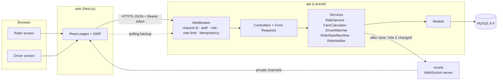
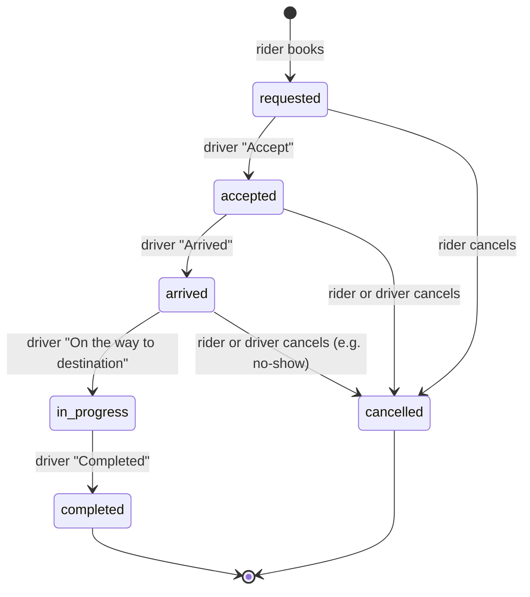

# Architecture

This page explains how the app is built, then answers the 8 architecture
questions.

**Contents:** [How it fits together](#how-it-fits-together) ·
[Database tables](#database-tables) ·
[Ride steps](#ride-steps) ·
[The 8 questions](#the-8-questions)

---

## How it fits together



There are four containers, all started by `compose.yaml`:

| Container | What it does |
|---|---|
| `web` | The Next.js app the rider and driver use |
| `api` | The Laravel API: all business rules live here |
| `reverb` | WebSocket server that pushes "this ride changed" to the screens |
| `mysql` | The database |

**How a request moves through the API:**

```text
Form Request  →  Controller  →  Service  →  Model  →  API Resource
(checks input)   (HTTP only)    (rules +    (database) (JSON reply)
                                 transactions)
```

Every success reply has the same shape, and so does every error reply.

---

## Database tables

| Table | What it stores |
|---|---|
| `users` | Riders and drivers (the `role` column says which) |
| `drivers` | Car, category, status (offline / available / on_trip), location, city |
| `cities`, `places` | The service area, currency and pickup places |
| `fare_rules` | Prices per city and category: base, per km, per minute, minimum, commission |
| `rides` | Each ride: status, fare (in paisa, as whole numbers), timestamps |
| `ride_assignments` | Which driver took the ride, and how far away they were |
| `ride_events` | Every status change: from, to, who, when |
| `idempotency_keys` | Saved replies for retried requests (kept 24 hours) |

The fare is **copied onto the ride** when it is booked. If prices change
later, old rides keep their original price.

---

## Ride steps



- These rules live in **one place**: `RideStateMachine`. Any other move is
  refused with `409 invalid_transition`.
- A ride **can be cancelled until the trip starts**. Once it is `in_progress`,
  it can only be completed.
- **"I'm coming" is a message, not a step.** When the driver has arrived, the
  rider can tap it and the driver sees "The rider is coming". The driver does
  not have to wait for it. Tapping it twice changes nothing.

---

## The 8 questions

### 1. Why this stack and architecture?

**Tools I know well, which handle the hard parts out of the
box, in one well-organised API.**

| Choice | Why |
|---|---|
| **Laravel 13 (PHP 8.4)** | The backend I know best, so my time went into the hard parts (concurrency, retries, tests). It includes validation, migrations, token login, queues, broadcasting and testing tools. |
| **MySQL 8.4** | Row locks, unique indexes and distance functions. That is all this problem needs, with no extra infrastructure. |
| **Next.js + TypeScript** | The preferred frontend. SWR handles caching, polling and reloading. |
| **Laravel Reverb** | A WebSocket server with no third-party account. The rider sees "driver accepted" immediately. |
| **One API with clear layers** | For one city and a small team, separate services would only add network failures and deployment work. The folders `Rides`, `Dispatch` and `Auth` are where I would split it later (see question 6). |

### 2. How do you stop two drivers accepting the same ride?

**A database lock lets only one driver through, and unique
indexes block anything that slips past it.**

1. **Lock.** When a driver accepts, `RideService::accept` locks the ride row,
   then the driver row, always in that order (so two requests can't block each
   other forever). The second driver waits, then sees the ride is already
   `accepted` and gets `409 invalid_transition`.
2. **Safety net.** The `rides` table has a unique index on `active_driver_id`.
   It holds the driver's id only while their ride is active. So the database
   itself refuses to give one driver two active rides. `active_rider_id` does
   the same for riders.

The driver's status changes from `available` to `on_trip` in the same
transaction, so one driver can't accept two rides at once either.

**Proven by a real test.** `tests/Concurrency/RaceConditionTest.php` starts
separate processes at the same moment against real MySQL:

| Situation | Result |
|---|---|
| 5 drivers accept one ride | Exactly 1 wins; 4 get `409` |
| 1 driver accepts 2 rides | Only 1 succeeds |
| A rider taps "Book" 3 times | Only 1 ride is created |
| The rider cancels while a driver accepts | Only one of them wins |

As a check, I removed the lock: the test failed.

### 3. How do you handle retries and duplicate requests?

**Every action that changes a ride carries an
`Idempotency-Key`. Sending the same key again returns the first answer instead
of doing the action twice.**

| What happens | Reply |
|---|---|
| Same key, same request | The saved reply, with `Idempotent-Replayed: true`. Nothing runs twice |
| Same key, first try still running | `409 request_in_progress` |
| Same key, different request body | `422 idempotency_key_reused` |
| The first try failed with a server error (5xx) | The key is released so the client can try again |

- **The app** makes one key per button press and reuses it for its automatic
  retries. If a reply gets lost, the retry gets the original ride back instead
  of booking a second one.
- **Two tabs, two different keys?** A rider still can't have two active rides:
  the service checks, and the `active_rider_id` unique index blocks the race.
- **Too many requests.** Sign-in allows 5 tries per minute per email and IP.
  The rest of the API allows 120 requests per minute per user.

### 4. What does the frontend do when a request fails?

**It retries only when that is safe, and otherwise shows a
clear message with a "Try again" button. The screen never goes blank.**

- **One error type.** Every failure becomes an `ApiError` with a status, code,
  message and request id. No connection becomes `network_error`; no reply
  within 10 seconds becomes `timeout`.
- **Safe retries only.** Actions retry up to 2 times, and only when the server
  never answered. They reuse the same idempotency key. A clear answer such as
  `409` is shown to the user, not retried.
- **What the user sees.** A plain message, a "Try again" button, and the
  request id to quote to support. If only a background refresh fails, a small
  "Live updates paused" note appears and the ride stays on screen.
- **Specific cases:**
  - the rider already has a ride → they are taken to it;
  - another driver was faster → the request list refreshes;
  - a cancel fails → the ride reloads to show its real status;
  - the login has expired (`401`) → back to the sign-in page.
- **Loading and empty states.** Grey placeholders shaped like the content, and
  messages such as "No ride requests right now".
- **If live updates drop.** The screen checks for changes every 4 seconds
  instead of every 30. Live messages only say "this ride changed" and the
  screen then reloads the ride, so a missed message can't leave it showing
  the wrong status.

### 5. How would it scale to many cities and thousands of users?

**Cities are already built in. For more users, run more API
copies, and move driver locations to Redis.**

**More cities (already supported).** Each city has its own service area,
currency and prices. Rides and drivers belong to a city, and matching looks in
that city first. Adding a city means adding data, not code. Next steps would be
exact city borders (polygons), time zones per city, and surge pricing per area
(every ride already stores a `surge_multiplier`).

**More users:**

| Part | Plan |
|---|---|
| **API** | It keeps no session state, so run several copies behind a load balancer |
| **Database** | Read copies for history and lists; bookings and locks stay on the main database. The busy queries already have indexes |
| **Driver locations** | The biggest load (every driver, every few seconds). Move them to Redis GEO; MySQL keeps only the last known position |
| **Finding nearby drivers** | Redis GEO or map grid cells (H3 or geohash) to find drivers close by, then sort by real road time from a routing service (OSRM or Google) instead of straight-line distance × 1.3. Offer the ride to the nearest 5 first, then widen |
| **WebSockets** | Run several Reverb copies, linked through Redis |
| **If one database is not enough** | Split by city, since rides almost never cross cities |

### 6. When would you add Redis, a message broker, or separate services?

**Redis first, a queue when side effects grow, separate
services only when a part really needs it.**

- **Redis: first.** As soon as there is more than one API copy or live GPS.
  It gives shared rate limits and cache, driver locations (GEO), scaling for
  Reverb, and background jobs. Cheap and well understood.
- **A queue or message broker: when side effects are slow or must not be
  lost.** For example push notifications, SMS, receipts, analytics and payment
  webhooks.
  - Start with Laravel queues on Redis.
  - Move to Kafka, SQS or RabbitMQ when several systems need the same events
    (billing, analytics, fraud) or events must be replayed.
  - Add an "outbox" table so an event is never lost after a save. Today,
    notifications are sent after saving on a best-effort basis. That is fine
    because the screens also poll.
- **Separate services: only for a clear reason**, such as a part with very
  different scaling or release needs and a team to own it. Matching (heavy
  location work) and payments (compliance) would be first. Splitting too early
  mostly adds new ways to fail.

### 7. How would you deploy, monitor and roll back?

**Tested, versioned Docker images; logs, errors and alerts in
one place; roll back by redeploying the previous image.**

**Deploy:**
- **CI** runs every backend test (including the concurrency tests on real
  MySQL) plus the frontend checks, tests and build, then builds versioned
  Docker images. A sample is in `.github/workflows/ci.yml`.
- **API:** containers on ECS, Kubernetes or Laravel Cloud/Forge, behind a load
  balancer, using php-fpm + nginx or Octane instead of PHP's built-in server.
- **Frontend:** Vercel or a Node container.
- **Database:** managed MySQL (RDS or Cloud SQL) with backups and
  point-in-time recovery.
- **Secrets** come from the hosting platform's secret manager, never from git.
- **Zero-downtime releases:** rolling or blue-green deploys, with health
  checks on `/api/health`.
- **Safe database changes:** migrations add new things first and remove old
  ones in a later release, so the old and new versions can run side by side.

**Monitor:**
- **Already built:**
  - JSON logs with a request id on every line, also returned in the
    `X-Request-Id` header and shown on error screens;
  - one log line per request, with its status and time;
  - business events such as `ride.requested`, `ride.accepted`,
    `broadcast.failed` and `auth.login_failed`;
  - a health endpoint.
- **For production:**
  - send logs to a central store and errors to Sentry;
  - alert on slow responses (p95), 5xx errors, `409` conflicts, rides waiting
    with no driver, time until a driver accepts, and WebSocket connections.

**Roll back:**
- Redeploy the previous image. This is quick, because images are versioned
  and migrations stay compatible with the old version.
- Turn risky features off with a feature flag, without a deploy.
- Undo database changes only as a last resort; prefer a quick forward fix.

### 8. Top three improvements before production

1. **Real locations.** A driver phone app sending live GPS, Redis GEO for
   matching, real road distance and time from a routing service, and exact
   city borders. Today, a driver's position changes only when they finish a
   trip or pick their spot from a list, and distance is straight line × 1.3.
2. **Automatic dispatch.** Today, drivers look at a list and accept. Instead,
   offer each ride to one driver or a small group for a few seconds, re-offer
   it if ignored, expire requests nobody takes (and tell the rider), and share
   rides fairly between drivers. This needs background jobs and a scheduler.
3. **Production hardening:**
   - php-fpm or Octane instead of the built-in PHP server;
   - login tokens in secure httpOnly cookies instead of `localStorage`;
   - Sentry, metrics and alerts;
   - an outbox for reliable notifications;
   - payments, refunds and cancellation fees;
   - a review of personal data (phone numbers, how long location history is
     kept).

See [LIMITATIONS.md](LIMITATIONS.md) for the full list of known gaps.
