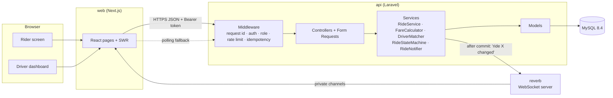
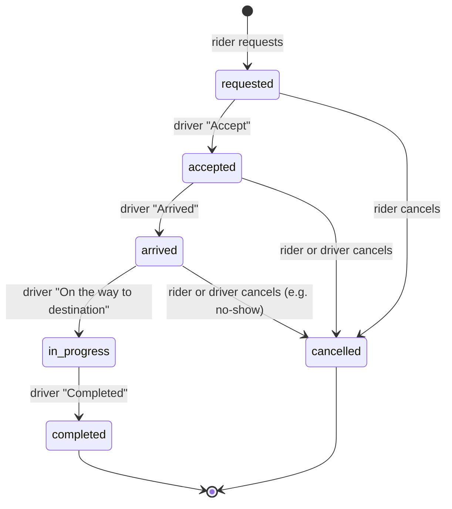

# Architecture

## Overview

Four containers in `compose.yaml`: `web` (Next.js), `api` (Laravel), `reverb`
(WebSockets, same image as `api`) and `mysql`.

**Request path inside the API:**
Form Request (validation) → Controller (thin, HTTP only) → Service (business
rules and transactions) → Model → API Resource → one JSON shape for success
and one for errors.

### Data model

| Table | Purpose |
|---|---|
| `users` | Riders and drivers (`role`). |
| `drivers` | Vehicle, category, `status` (offline / available / on_trip), last location, city. |
| `cities`, `places` | Service area (bounding box), currency, pickup points. |
| `fare_rules` | Price per city and category: base, per km, per minute, minimum, commission. |
| `rides` | The request, its status, the fare snapshot (integer paisa), timestamps. |
| `ride_assignments` | Which driver took the ride, from where, and how far they were. |
| `ride_events` | Every status change: from, to, who did it, when. |
| `idempotency_keys` | Saved answers for retried requests (24 hours). |

The fare is copied onto the ride when it is created, so later price changes
never alter a past ride.

### Ride lifecycle

`RideStateMachine` is the only place these rules live. Any other move is
rejected with `409 invalid_transition`. A ride can be cancelled until the
trip starts; once `in_progress` it can only be completed.

The rider's **"I'm coming"** is a message, not a status. While the ride is
`arrived` it sets `rider_coming_at` and the driver's screen shows "The rider
is coming". The driver can start the trip without it, so a rider who just
walks up to the car never blocks the trip. Sending it twice changes nothing.

---

## 1. Why this stack and architecture?

- **Laravel 13 (PHP 8.4).** It's the backend I know best, so my time went into
  the hard parts (concurrency, idempotency, tests) rather than plumbing.
  Out of the box it gives validation, migrations, Sanctum token auth, queues,
  broadcasting and a good testing setup.
- **MySQL 8.4.** Row locks (`SELECT … FOR UPDATE`), unique indexes on
  generated columns, and `ST_Distance_Sphere` for distance. That covers what
  this problem needs without extra infrastructure.
- **Next.js + TypeScript.** The preferred frontend. SWR handles caching,
  polling and refetching; the pages are small client components.
- **Laravel Reverb.** WebSocket server with no third-party account. Riders see
  "driver accepted" immediately; polling covers any gap.
- **One API, layered (a modular monolith).** Controllers stay thin, rules live
  in services, persistence lives in models. For one city and a small team,
  separate services would add network failures and deployment work with no
  benefit. The service boundaries (`Rides`, `Dispatch`, `Auth`) are where I
  would split later if needed (see question 6).

## 2. How do two drivers not accept the same ride?

Two layers: the lock does the work, and the database rejects anything that
slips past it.

1. **Row lock in a transaction.** `RideService::accept` locks the ride row
   (`lockForUpdate`) and then the driver row, always in that order so two
   requests can't deadlock each other. The second driver waits for the first
   to commit, then reads the ride as `accepted`, and the state machine
   rejects it with `409 invalid_transition`.
2. **Unique indexes as a safety net.** `rides.active_driver_id` is a stored
   generated column: the driver id while a ride is `accepted`, `arrived` or
   `in_progress`, otherwise `NULL`. A unique index on it means one driver can never hold two active
   rides. `active_rider_id` does the same for riders (one ride at a time).
   MySQL allows many `NULL`s in a unique index, so finished rides don't
   collide.

The driver's own status (`available` → `on_trip`) changes in the same
transaction, so a driver can't accept two different rides at once either.

**Tested for real.** `tests/Concurrency/RaceConditionTest.php` forks separate
processes that start at the same moment against real MySQL. With 5 drivers
accepting one ride, exactly 1 succeeds and 4 get `invalid_transition`. Other
cases: one driver accepting two rides at once, a rider tapping "request"
three times, and a rider cancelling while a driver accepts. When I removed
the lock as a check, the test failed. The unique index stopped the double
assignment, but as a database error instead of a clean `409`.

## 3. Retries and duplicate requests

- **Idempotency keys.** Every action that changes a ride (`POST /rides`,
  `accept`, `arrive`, `coming`, `start`, `cancel`, `complete`) requires an `Idempotency-Key` header.
  `EnsureIdempotency` claims the key first (unique on user + key). Then:
  - **Same key, same request:** the saved response is returned with
    `Idempotent-Replayed: true`, and nothing runs twice.
  - **Same key while the first try is still running:** `409 request_in_progress`.
  - **Same key with a different body:** `422 idempotency_key_reused`. The
    request is matched by a SHA-256 hash of method, path and body.
  - **Server error (5xx):** the key is released so the client can retry.
- **The frontend** creates one key per button press and reuses it for its
  automatic retries (network errors and timeouts only). A retry after a lost
  response returns the original ride instead of booking a second one.
- **Business-level duplicates.** Even with different keys (two tabs), a rider
  can't have two active rides: there is a check in the service, plus the
  `active_rider_id` unique index for the race.
- **Brute force.** Login is limited to 5 attempts per minute per email and IP.
  The rest of the API allows 120 requests per minute per user.

## 4. How does the frontend handle failed requests?

- **One error type.** All failures become an `ApiError` with `status`, `code`,
  `message` and `requestId`. Network failures and timeouts (10 seconds)
  become `network_error` and `timeout`.
- **Automatic retry only when it's safe.** Write actions retry up to 2 times,
  with backoff, and only when the server never answered. They reuse the same
  idempotency key. A clear answer such as `409` is shown, not retried.
- **What the user sees.** A plain message, a "Try again" button, and the
  request id as a reference for support. While the ride is still showing, a
  failed refresh shows a small "Live updates paused" warning instead of
  blanking the screen.
- **Specific codes are handled.** `active_ride_exists` takes the rider to their
  current ride. When another driver was faster, the list refreshes. A failed
  cancel reloads the ride to show its real status. A `401` clears the session
  and goes to the sign-in page.
- **Loading and empty states.** Skeletons shaped like the content, and empty
  states such as "No drivers nearby right now" or "No ride requests right now".
- **Live updates down.** If the WebSocket drops, polling speeds up from 30
  seconds to 4 seconds. WebSocket messages only say "this ride changed" and the
  screen reloads the ride from the API, so a missed message can't leave the
  screen showing wrong data.

## 5. Multiple cities and thousands of concurrent users

**Cities.** Already modelled. `cities` has a service-area box and currency.
`fare_rules` is per city and category. Rides and drivers carry `city_id`, and
matching filters by city first. A new city is data, not code: insert the city,
its places and its fare rules. Next steps would be polygon service areas,
per-city time zones, and surge pricing per zone (`surge_multiplier` is already
stored on every ride).

**Load.**
- **API.** It is stateless (bearer tokens, no server sessions), so it scales
  horizontally behind a load balancer: php-fpm or Octane with several
  instances.
- **Database.** Read replicas for history and lists; writes and locks stay on
  the primary. The hot queries are covered by indexes (`city, status,
  category` on drivers; active-ride indexes on rides).
- **Driver locations** are the biggest write load at scale (every driver every
  few seconds). They would move to Redis GEO (`GEOADD` / `GEOSEARCH`) instead
  of MySQL rows, with MySQL keeping only the last known position.
- **Matching.** For nearby-driver discovery in production I would use Redis
  GEO or H3/geohash cells per city to find candidates by distance, then rank
  by road ETA from a routing service (OSRM or Google) instead of straight-line
  distance × 1.3. Offers would go out in waves (nearest 5, then wider) with a
  timeout per wave.
- **WebSockets.** Reverb scales horizontally using Redis pub/sub between
  instances.
- **Partitioning.** If one database became a bottleneck, the natural split is
  by city: rides almost never cross cities.

## 6. When to add Redis, a message broker, or separate services

- **Redis, first.** As soon as there is more than one API instance or real
  location updates: shared rate limiting and cache, driver locations
  (GEO), Reverb scaling, and queue jobs. It's cheap and well understood.
- **A queue or broker** when side effects become slow or must not be lost:
  push notifications, SMS, receipts, analytics, payment webhooks. I would
  start with Laravel queues on Redis. Kafka, SQS or RabbitMQ come in when
  several independent consumers need the same events (billing, analytics,
  fraud) or when events must be replayed. To publish safely after a commit I
  would add an outbox table. Today, notifications are sent after commit and
  best effort, and that's acceptable because clients also poll.
- **Separate services** when a part has a clearly different scaling or release
  need, and a team to own it. Dispatch/matching (CPU and location heavy, hot
  path) and payments (compliance) would be first. Not before: a split
  monolith early on mostly adds network failure modes.

## 7. Deploy, monitor and roll back

**Deploy.**
- CI runs the backend tests (including the concurrency tests on real MySQL),
  the frontend typecheck, lint, unit tests and build, then builds versioned
  Docker images. A sample workflow is in `.github/workflows/ci.yml`.
- **API:** containers on ECS, Kubernetes, or Laravel Cloud/Forge, behind a
  load balancer, with php-fpm + nginx or Octane instead of PHP's built-in
  server. **Frontend:** Vercel or a Node container. **Database:** managed
  MySQL (RDS / Cloud SQL) with backups and point-in-time recovery.
- Secrets come from the platform's secret manager, never from the repository.
- Rolling or blue-green deploys with health checks on `/api/health`.
- Migrations are written to be backward compatible (expand, then contract), so
  the old and new versions can run against the same schema during a deploy.

**Monitor.**
- Already in place: JSON logs with a request id on every line (also returned
  as `X-Request-Id` and shown in the UI); one log line per request with
  status and duration; business events (`ride.requested`, `ride.accepted`,
  `broadcast.failed`, `auth.login_failed`); and a health endpoint.
- In production: ship logs to a central store, add Sentry for errors, and add
  metrics and alerts for p95 latency, 5xx rate, `409` rates (match
  conflicts), rides waiting with no driver, time to acceptance, and
  WebSocket connection counts.

**Roll back.**
- Redeploy the previous image tag. This is fast because images are versioned
  and migrations are backward compatible.
- For risky features, a feature flag turns them off without a deploy.
- Database rollbacks are a last resort. I prefer a forward fix, which is why
  migrations avoid destructive changes in the same release.

## 8. Top three improvements before production

1. **Real geography.** Live driver locations (a driver app sending GPS
   updates), Redis GEO matching, road distance and ETA from a routing
   service, and polygon service areas. Today, drivers' positions only change
   when they complete a trip, and distance is straight line × 1.3.
2. **Dispatch that doesn't depend on drivers looking at a list.** Timed offers
   to one driver or a small group, automatic re-offer when ignored, expiry of
   unaccepted requests with a rider notification, and fair distribution
   between drivers. This needs queued jobs and a scheduler.
3. **Production hardening.** php-fpm or Octane instead of the built-in server;
   tokens in httpOnly cookies through a backend-for-frontend instead of
   `localStorage`; Sentry, metrics and alerts; an outbox for reliable
   notifications; payments, refunds and cancellation fees; and an audit of
   personal data (phone numbers, location history retention).

See [LIMITATIONS.md](LIMITATIONS.md) for the full list of known gaps.
